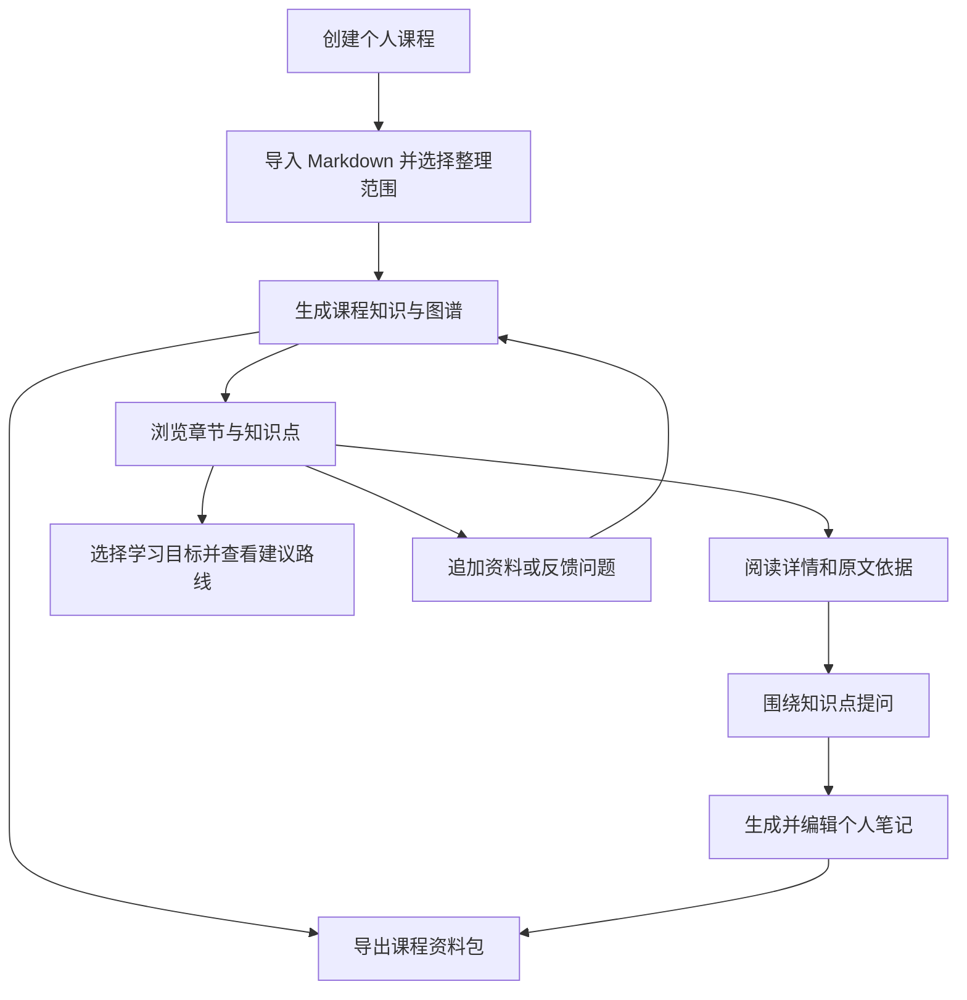

# 校园课程学习助手：比赛 Demo 产品方案

状态：产品方案 v0.1，Q1—Q22 的范围与行为均已确认。本轮产品方案讨论完成，尚未进入实现，也未进行功能验收。

## 1. 产品定位与目标

面向大学生个人使用的课程学习助手。学生导入教材和课堂资料，系统持续整理课程知识，以知识图谱和知识点页面支持理解、问答、笔记与学习路线推荐。

此次交付目标是可运行的比赛 Demo，主场景为日常课后学习。学生独立建立课程学习空间，开始使用不依赖老师参与。比赛没有额外要求；目前未确定开发排期。

采用 LLM Wiki 持续整理、关联和维护知识的思想，不绑定特定现成项目；生成的知识需要可以浏览、追溯和导出。

## 2. 材料与演示范围

首本教材：`/root/pdfclean/cleanpdf/书籍合集/计算机操作系统（第四版）.md`，汤小丹等编著，中文，12 章。

本次完整演示范围：

- 第 2 章：进程的描述与控制。
- 第 3 章的 3.5—3.8 节：死锁概述、预防、避免、检测与解除。

第一版接收 Markdown。学生可以选择整理范围，并区分已经导入的资料与已经整理成知识的内容。处理选定范围不表示整本教材已经完成知识整理。

已有材料的边界：章节编号可用，但标题层级有混乱，仍有少量扫描残留；首书的 308 处图片引用在对应相对位置缺少图片。支持文字、公式和代码展示，缺失图片明确标注；需要依赖缺失图形的问题提示资料不足。第一版不包含图片理解，也不保证自动修复所有公式或识别错误。

## 3. 核心功能与行为

| 功能 | 第一版行为 |
| --- | --- |
| 课程与资料 | 学生建立个人课程学习空间，导入 Markdown，选择整理范围，查看资料是否已经完成知识整理 |
| 知识图谱 | 章节与知识点两类节点；包含、前置、对比三类关系；默认章节概览，逐章展开，支持查看跨章节关联及全图 |
| 知识点页面 | 展示知识说明、来源与关联知识；适用时展示公式和代码；打开详情后保留图谱位置，并可继续提问 |
| 课程问答 | 默认使用当前课程知识库，支持按资料或章节限制范围；选中的知识点只是提问焦点，不自动缩小到单个知识点 |
| 个人笔记 | 将所选知识点、解释或问答生成个人笔记，编辑并保存；知识库更新不覆盖学生的修改 |
| 学习路线 | 根据学习目标、当前章节与知识关系给出学习顺序，在图谱中突出显示相关知识点和顺序 |
| 追加资料 | 向同一课程追加 Markdown，整合相同概念、建立新知识点，更新已有页面并保留来源 |
| 问题反馈 | 对知识点或关系说明问题，系统回查资料并重新整理相关内容，保留个人笔记 |
| 导出 | 导出知识页面、关系索引、个人笔记和已导入原始 Markdown，保留页面关联、来源引用与拓展标记 |

### 图谱关系的含义

- **包含**：某章节涵盖某知识点。
- **前置**：建议先理解一个知识点，再学习另一个知识点；不能仅凭章节出现顺序认定前置关系。
- **对比**：两个知识点适合放在一起辨析。

关系需要有依据，模型推断需要标识。例题和公式可放在知识点页面中，第一版不把它们作为独立节点。

### 资料依据与模型补充

默认回答依据上传资料，关键结论能定位到原文章节或段落。资料不足时明确说明，不把未经支持的内容归给教材。

学生可以主动选择拓展解释。拓展内容标为模型补充，不自动写入课程知识库；如果学生把含拓展内容的回答保存为个人笔记，标记应保留到笔记和导出资料包中。

### 多份资料与个人成果

同一概念按含义整合不同来源，不能仅凭名称相同合并。不同资料的相互矛盾表述并列展示并保留出处，不静默覆盖。

知识点页面随资料更新，个人笔记单独保留。相关来源变化时提示学生检查笔记，由学生决定是否修改。问题反馈用于回查资料，不自动成为教材事实。

### 学习建议的边界

学习路线依据目标和知识结构，属于建议的学习顺序。第一版不采集短测表现来诊断薄弱点，也不声称知道学生的掌握程度；没有长期复习调度功能。

## 4. 完整用户流程

用户始终能够理解当前课程、提问范围以及已经整理的范围。需要离开知识点查看原文或提问时，图谱的浏览位置应被保留。

## 5. 更新过程（Q22，已确认）

追加资料和纠错重新整理都遵循以下可见行为：

1. 整理期间，原有知识库仍可浏览和提问；新资料的整理状态清晰可见。
2. 成功后一起更新相关图谱、知识点页面和来源信息，并展示本次新增、补充或有冲突的内容。
3. 失败时保留原有知识库，说明未完成的整理任务，并允许重试；首次构建失败则不显示已经有可用知识库。
4. 个人笔记保持原样；与成功更新内容相关的笔记显示来源变化提示。

以上约定产品的可见行为，具体实现方式留待技术方案讨论。

## 6. 比赛演示流程

预先用真实教材构建基础知识库，保留重新构建入口。在准备样本时，从已经选定的演示范围中留出一小段作为现场增量资料；摘录保留真实来源，不把教材摘录伪称为教师新发的材料。演示结束时覆盖约定的内容范围。

| 步骤 | 演示操作 | 观众能看到的结果 |
| --- | --- | --- |
| 1 | 打开操作系统课程，查看资料与整理范围 | 教材、已整理内容及章节概览 |
| 2 | 展开进程相关章节，选择进程或线程 | 图谱关联、可阅读的知识点页面及原文依据 |
| 3 | 问“进程和线程有什么区别？” | 综合相关知识的回答，带可定位的来源 |
| 4 | 生成学习笔记并加入自己的说明 | 可保存、可编辑的个人学习成果 |
| 5 | 选择学习目标“理解死锁” | 建议的学习顺序与图谱突出显示，标明推断关系 |
| 6 | 现场导入留出的短 Markdown | 新增或补充的知识点、页面与来源变化 |
| 7 | 再次查看相关知识与之前的笔记 | 课程知识已更新，学生自己的笔记仍然保留 |
| 8 | 导出课程资料包 | 可在应用之外阅读的知识、笔记和对应原文 |

反馈纠错和资料不足回答另外准备短操作案例，用于验证相应能力；不要求把所有异常情况塞进一次主演示。

## 7. Demo 验收标准

以下是将来需要验证的标准，不是已通过的测试结果。验收不预先承诺处理时长、知识点数量或准确率百分比。

| 能力 | 可观察的通过条件 |
| --- | --- |
| 真实资料处理 | 导入选定 Markdown 后能生成与实际内容对应的知识；未整理章节不会被显示为已完成；有重新构建入口 |
| 内容展示 | 文字、选定公式和代码能够阅读；缺失图片明确显示缺失，不能回答依赖未提供图形的问题 |
| 图谱与页面 | 两类节点和三类关系含义明确；能够逐章展开、查看跨章节关联、打开知识点及其原文出处 |
| 带依据问答 | 概念解释、概念对比和跨知识点问题能引用支持结论的资料位置；引用能够打开；没有依据的问题明确说明不足 |
| 拓展边界 | 拓展解释需由学生主动选择，标识明确；不自动混入课程知识库，保存为笔记及导出后仍保留标记 |
| 个人笔记 | 能基于知识或问答生成、编辑和保存；更新相关课程知识后，个人修改仍在，并在相关来源变化时给出提示 |
| 学习路线 | 能围绕指定目标列出有序知识点并在图谱显示；说明建议依据或推断属性，不把结果称为掌握度诊断 |
| 追加资料 | 新资料能补充已有概念或形成新概念；原有来源可追溯；遇到真实冲突保留不同说法及出处，不直接覆盖 |
| 反馈纠错 | 能提交针对知识点或关系的问题并回查资料、重新整理相关内容；未解决的问题不能仅因任务执行完成就声称已修正 |
| 可移植导出 | 资料包包含已约定的四类内容，知识页面链接与来源引用可用，个人笔记与拓展标记保留；不承诺恢复原本缺失的图片 |
| 更新一致性 | 成功更新后图谱、页面与出处一致；更新失败时既有知识库及个人笔记仍可使用，可重试未完成任务 |

通过这些标准，才能说明系统完成了从实际资料到课程知识、学习使用与持续更新的完整过程。

## 8. 第一版明确不纳入的能力

- PDF、扫描 PDF 与 OCR 输入。
- 图片理解及缺失图像的自动恢复。
- 例题、公式作为独立图谱节点。
- 短测诊断、长期掌握度评估和自动复习调度。
- 自由绘制或任意编辑整张图谱。

教师参与与班级共享不属于当前选定的个人使用主流程。后续已确认技术栈、统一 Flash 模型、存储及本机交付方式，详见 [技术方案 v0.1](technical-design.md)；运行耗时等性能表现待实现后验证。

## 9. 相关文档

- [技术方案 v0.1](technical-design.md)
- [开发任务清单](implementation-plan.md)
- [方案讨论与决策树](design-discussion.md)
- [领域术语](../CONTEXT.md)
- [ADR 0001：课程知识与个人笔记分开维护](adr/0001-separate-course-knowledge-and-personal-notes.md)
