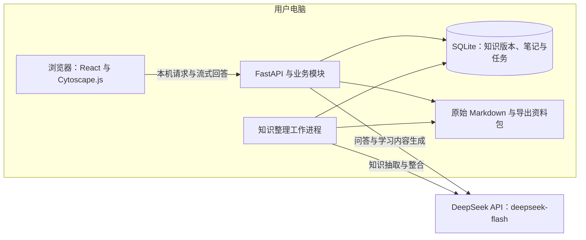

# 校园课程学习助手：技术方案 v0.1

状态：Q23—Q39 均已确认，本轮技术方案讨论完成，尚未开始实现。以 [产品方案 v0.1](product-plan.md) 为范围，具体开发拆分见 [开发任务清单](implementation-plan.md)。

## 总体结构

本机单人、多课程的 Web 应用：React + TypeScript + Vite 构建界面，Cytoscape.js 展示知识图谱，Python + FastAPI 提供本机接口和静态界面。本机工作进程顺序执行知识整理任务，SQLite 保存课程知识及任务状态，所有模型能力由 `deepseek-flash` 提供。

图中区分运行进程与持久数据；模块职责见 Q37。前端不直接调用模型接口。知识更新通过候选版本校验与发布完成，原始资料和个人笔记分别保留。

## 继承的产品约束

- 面向大学生个人使用的比赛 Demo，支持多份课程 Markdown 的知识整理、图谱、问答、个人笔记、学习路线与导出。
- 章节和知识点为两类节点，包含、前置、对比为三类关系；资料依据与模型推断需要区分。
- 原文引用能定位，课程知识与个人笔记分开维护，拓展解释不自动写入课程知识库。
- 整理期间旧知识库可用，成功后图谱、知识页面与来源一起更新，失败保留旧内容并可重试。
- 演示使用真实预构建知识库加现场短资料增量，保留重新构建入口。
- 本阶段讨论架构、数据组织、模型处理流程和任务拆分，不编写应用实现。

## 已查明的开发环境事实

只读检查当前工作区和开发工具，未读取凭据、安装依赖或启动服务：

- 开始技术讨论时，项目仅有产品方案、讨论记录、领域术语与一份 ADR；本阶段只增加设计文档，仍无应用源码、依赖清单、锁文件或启动配置。
- 未发现适用的 `AGENTS.md`。
- 当前开发环境是 Ubuntu 24.04.4 LTS / WSL2，x86_64；可见 24 个逻辑 CPU、约 9.7 GiB 内存。
- 已安装 Node 24.15.0、npm 12.0.1、Python 3.13.13、Docker CLI 29.6.1、git 2.43.0。仅检查可执行工具版本，没有验证项目依赖兼容性或 Docker daemon。
- GPU 查询被操作系统阻止，无法确认当前环境的 GPU 型号、显存或推理可用性；这不等于确认没有 GPU。
- 尚未验证浏览器、外部模型 API 或最终比赛机器。当前开发环境不能自动作为比赛部署环境。

## 已确认的技术约束

- **Q23：交付与运行位置。** 第一版在用户电脑上启动，通过本机浏览器演示，不要求部署可分享的公网网址。
- **Q24：模型接入。** 使用联网 DeepSeek API。当前只做方案讨论，尚未调用收费模型接口，也未检查账户密钥。
- **Q25：技术维护偏好。** 没有必须采用的语言或框架，由候选方案的取舍决定；没有现有应用代码需要迁移。
- **Q26：预算。** 用户表示比赛项目无需担心预算，费用不作为当前选型的限制；无需再要求用户先制定费用上限。模型选择仍需考虑效果、延迟及任务可靠性。
- **Q27：本机使用形态。** 一个本地使用者可建立多门课程，无登录注册流程，仅供本机访问；不同课程的资料、知识和笔记分别保存。
- **Q28：应用技术栈。** React + TypeScript + Vite 构建界面，Cytoscape.js 展示图谱，Python + FastAPI 承担后端。演示交付由本机后端提供构建后的界面与业务接口，用户通过一个地址访问。
- **Q29：知识的权威存储。** SQLite 保存课程知识状态、关系、来源定位、版本、个人笔记与持久任务记录，Wiki 和笔记正文采用 Markdown。原始教材文件保存在本地，图谱、页面、问答与导出读取同一份已发布知识；不自动同步应用外修改的导出文件。
- **Q30：整理过程的控制方式。** 程序控制识别章节与原文、抽取、整合、生成、校验和发布的固定步骤，DeepSeek 负责理解与生成；失败可定位并针对相关步骤重试，模型不自主决定任意文件读写。
- **Q31：版本与引用。** 每次整理生成候选知识版本，校验通过后发布；图谱、详情与一次问答绑定同一版本，旧回答和笔记保留当时的原文引用。程序管理原文片段标识和定位，校验模型引用的标识、范围及引用文本。
- **Q32：检索。** 第一版使用概念目录、别名、中文关键词及图谱关联寻找知识，再回查原文；难以直接匹配时可由 DeepSeek 从课程概念目录选择知识点，程序校验范围。暂不依赖向量检索，样例召回存在明显不足时再补充。
- **Q33：任务执行。** 本机后台工作进程配合 SQLite 持久任务与步骤结果，每次执行一个知识整理任务；浏览、笔记和问答继续读取已发布知识。中断后复用已保存结果，可重试错误有限重试；不承诺外部模型请求恰好执行一次。
- **Q34：概念身份。** 知识点在课程内拥有稳定标识，名称及别名不作为身份本身，可关联多个章节；追加资料按定义、上下文和出处识别同一概念，无法确认时保留独立知识点并标记待核对。
- **Q35：模型配置。** 用户明确指定所有模型调用统一使用 `deepseek-flash`，包括抽取、整合和问答。抽取与整合开启思考，交互问答默认关闭思考；保留 Responses、结构化抽取及流式回答方案。选择新版 Flash 的依据是用户对其能力的判断，不是成本取舍；本项目尚未实测效果。后续验证 Flash 的任务表现与模式参数，不把 Pro 作为默认对照或回退模型。
- **Q36：学习路线。** 程序按目标与前置关系计算所需知识及顺序，模型解释理由；包含和对比关系不参与前置排序。循环和缺口明确标记，只展示能够确定的部分，不将不完整结果描述为完整路线。
- **Q37：模块与交付。** 同一项目中划分资料、知识、整理任务、学习、个人笔记和导出六个模块，统一 DeepSeek 适配器。初次准备完成后用一条命令启动本机后端与工作进程，通过一个本机地址访问，不要求桌面安装包。
- **Q38：开发顺序。** 依次完成真实资料到图谱、学习使用、持续更新与恢复、演示交付四个里程碑。
- **Q39：验证策略。** 约 20 个真实教材代表问题用于检查模型回答与出处支持，程序测试验证稳定约束；可控响应复现失败与异常，正常演示采用真实资料与真实模型流程。

## 讨论结论

技术方案阶段没有待回答的选型或架构问题。模型参数的具体限额、依赖锁定版本及运行耗时等，需要在实现阶段依据实际兼容性和样本验证确定，不视为已经测得的结果。

产品与技术方案的确认不表示已经启动实现，也不表示应用或测试已经通过。后续按 [开发任务清单](implementation-plan.md) 推进。

## 学习路线、模块与交付（Q36—Q39）

### Q36：学习路线

由程序根据目标知识点及其前置关系计算需要学习的知识与顺序，模型负责解释安排理由。包含关系用于章节组织，对比关系用于辨析，不把这两类关系混作前置边。

使用带资料依据或明确标识为系统建议的前置关系，保留其性质。对目标相关范围检测循环和缺口；无法得到确定顺序的部分标记待核对，能够确定的部分可以展示，但不能把不完整结果称为完整路线。路线用于学习建议，不代表学生已掌握其中的知识。

### Q37：模块职责与本机交付

在同一个项目内按六个模块组织后端。每个模块通过少量业务接口承担相应复杂度，调用方不直接修改其他模块拥有的数据。

| 模块 | 主要职责 | 对外接口的业务含义 |
| --- | --- | --- |
| 资料 | 保留原文、识别章节、生成可定位片段 | 导入资料、读取章节与原文片段 |
| 知识 | 管理概念身份、知识版本、关系、页面及一致发布 | 读取指定知识版本、校验并发布候选版本 |
| 整理任务 | 执行固定步骤，持久记录进度与恢复状态 | 发起整理或纠错、查询进度、重试失败任务 |
| 学习 | 按范围检索、形成带依据回答、计算并解释学习路线 | 提问、请求学习路线 |
| 个人笔记 | 生成和保存可编辑笔记，保留引用与变化提示 | 生成笔记、保存修改、读取笔记 |
| 导出 | 汇集指定知识版本、个人笔记与原文，生成可独立阅读的资料包 | 导出当前课程 |

DeepSeek 调用集中在一个适配器中。运行时适配器只使用 `deepseek-flash`；验证用的可控响应适配器用于重现失败与边界情形，不作为比赛的真实模型输出。模型调用凭据由后端持有。

演示交付采用项目文件和本机启动脚本：初次准备依赖与前端构建产物后，一条启动命令运行后端与后台工作进程，并提供一个本机浏览器地址。数据存放在独立的本地数据目录；本轮不要求桌面安装包。

### Q38：开发里程碑

按可验证的完整操作逐步推进：

1. **真实资料到图谱**：用一小节实际教材确认 Flash 接入、结构化输出及来源定位，再贯通导入、整理、持久保存、图谱和知识详情。
2. **学习使用**：完成范围问答、个人笔记、学习路线与必要的图谱交互。
3. **持续更新与恢复**：完成追加资料、概念整合、问题反馈、版本切换和任务中断恢复，验证旧笔记及引用保留。
4. **演示交付**：完成资料包导出、真实样本预构建、现场增量脚本、本机启动说明与验收。

实现仍需后续明确开始；本阶段只确定开发顺序，不执行安装、模型调用或应用搭建。

### Q39：验证策略

准备约 20 个有教材依据的代表问题，覆盖概念解释、名称变化或模糊表达、跨知识点推理及资料不足；为每题记录可接受回答要点和支持位置。真实 Flash 验证关注回答内容、引用支持和响应表现，不要求自然语言逐字相同，也不依赖另一个模型单独充当正确性标准。

程序层面验证稳定约束：课程与提问范围、知识版本读取一致性、片段引用存在且属于允许范围、概念标识与别名、前置循环与缺口、任务中断后恢复、失败不发布、笔记不被覆盖，以及导出链接可用。模型失败和不合法输出通过可控响应重现；正常演示必须走真实资料和真实模型生成流程。

验收仍遵循产品方案已有标准，以上是实现阶段的验证安排，不表示已经写出或运行测试。

## 已确认的数据与执行规则（Q31—Q35）

### Q31：版本与引用

每次整理先形成新的候选知识版本，通过校验后再切换当前发布版本。图谱、详情与一次问答固定读取同一知识版本；旧回答及笔记的引用仍能回到当时对应的资料，不因新版本发布而改指其他内容。

原始资料保留，程序为原文片段分配稳定标识并维护章节、段落及原文位置。模型只引用本次提供的片段标识，程序验证标识、范围和引用文本；不让模型自行编造页码或原文行号。定位校验只说明引用存在，结论是否得到资料支持仍需独立验收。

### Q32：检索

第一版采用概念目录、别名、中文关键词检索和图谱关联寻找知识页面，再回查支持答案的原文。对直接匹配困难的问题，可让 DeepSeek 从课程概念目录中选择相关知识点，程序校验选择范围后继续检索；不能把没有命中误说成资料肯定不存在。

此路线暂不依赖向量检索或独立向量数据库。代价是部分问题可能增加一次模型请求，且措辞不同、隐含概念与跨章节问题的召回效果需要样例检验；若出现明显不足，再引入向量检索。SQLite 的中文分词与两字短词问题必须在实际检索方法中处理。

### Q33：本机持久任务

使用本机后台工作进程，配合 SQLite 保存任务、处理步骤、成功结果和失败原因。第一版每次执行一个知识整理任务，浏览、笔记操作和问答可继续使用已发布知识。

中断后复用已保存的成功步骤，继续未完成工作；对可重试错误采用有限次数重试，其他失败明确显示。已发给模型但尚未保存结果的调用在重试时可能再次执行，不承诺外部请求恰好执行一次；课程知识发布需要避免重复写入。

### Q34：概念身份

在课程内为知识点分配长期稳定的标识，名称和别名不作为身份本身。同一知识点可以出现在多个章节；追加资料时结合定义、上下文和资料依据判断是否沿用已有标识。

无法确认是同一概念时先保留独立知识点并标记待核对，不因同名强行合并。该策略有利于保留笔记、关系和历史引用，代价是可能出现需要后续纠错的重复候选概念。

### Q35：模型接入与初始配置

后端使用 DeepSeek `/responses`，全部任务统一采用 `deepseek-flash`。抽取与概念整合开启思考并采用 JSON Schema 输出，交互问答默认关闭思考并采用流式响应；目录路由、笔记生成、路线解释等其他模型任务同样使用 Flash。

这是用户确认的模型选择，替代此前提出的分模型候选配置。实施阶段用教材样例验证 Flash 在不同任务与思考模式下的引用正确性、整合效果、输出可靠性和响应耗时，调整模式或提示参数；不擅自改回 Pro，也不跳过来源和发布校验。

## 已确认选择的理由与取舍（Q27—Q30）

### Q27：本机单人使用

使用一个本地使用者，可建立多门课程，第一版不设置登录注册流程；应用仅面向本机访问。需要可分享网站或多人账户时再单独设计用户身份与资料隔离，不把本机演示直接当作公网部署方案。

### Q28：应用技术栈

| 用途 | 已选技术 | 选择理由与代价 |
| --- | --- | --- |
| 浏览器界面 | React + TypeScript + Vite | 承担图谱与知识详情、问答、笔记等交互；需要独立类型检查与前端构建 |
| 图谱展示 | Cytoscape.js | 主要任务是浏览知识网络、查看邻域与突出显示关系；布局和学习路线语义仍由应用明确组织 |
| 本机后端 | Python + FastAPI | 组织教材处理、知识更新和 DeepSeek 调用；采用两种语言，需要明确前后端的数据约定 |
| 演示启动 | 后端提供构建后的前端和业务接口 | 初次准备完成后，一条命令运行后端及工作进程，通过一个本机地址访问界面 |

以上技术已选定，但尚未安装或验证整套依赖。曾考虑以 TypeScript 后端统一语言，以及以 React Flow 支持图上直接连线编辑；本次选择优先适配教材处理和浏览知识网络的既定用途。

### Q29：知识的权威存储

使用 SQLite 保存课程、知识点身份、关系、来源定位、知识版本、个人笔记及持久任务记录；Wiki 和笔记的正文保留 Markdown 形式，作为持久内容保存。原始 Markdown 文件保存在本地资料目录，导出时生成包含原文和知识内容的完整资料包。

图谱、知识点页面、问答和导出都读取同一份已发布知识，避免分别维护可独立修改的图谱数据和 Wiki 文件。相应代价是日常维护主要通过应用进行；导出后可以独立阅读，但第一版不承诺自动同步用户在应用外修改的导出文件。

另一条路线是 Markdown 文件加元数据作为权威存储，数据库仅作为索引。这更适合直接在文件编辑器中维护 Wiki，但需要额外处理文件修改、关系更新、引用与发布一致性。本项目已经选择通过应用反馈纠错，因此采用前一种方案。这里的权威存储指应用的知识状态；教材原文仍是核实资料依据的来源。

### Q30：固定步骤组织资料整理

由程序控制处理步骤，DeepSeek 负责其中的知识理解与生成：

1. 识别资料与章节，建立可引用的原文片段。
2. 分章节抽取候选知识点、关系及资料依据。
3. 与现有知识整合，区分已有概念、新概念及冲突。
4. 生成或补充知识点页面。
5. 校验结构、来源定位、关系和页面的一致性。
6. 成功后发布新的知识版本，失败保留当前版本。

单个步骤失败时能定位并重试，学习资料作为参考内容处理，不能改变程序的处理规则。相比由自主 Agent 决定文件读写与维护步骤，第一版选择上述可追踪的流程。持久任务、检索路线与单任务执行方式已在 Q31—Q34 确认。

## 已查证的 DeepSeek 能力

查证日期：2026-10-24，仅阅读官方文档，没有进行模型调用或效果测试。

- 官方当前 `deepseek-flash` 映射 DeepSeek-V4.1-Flash-1017，支持思考与非思考模式。本项目已按用户要求统一选择 Flash；尚未进行本项目效果测试。[模型详情](https://api-docs.deepseek.com/quick_start/pricing/)
- `/responses` 支持 `text.format` 的 `json_schema` 输出以及 SSE 流式响应；文档没有详列全部 JSON Schema 关键字的支持范围。结构约束不等于内容正确，仍需校验出处、标识与业务关系。[Responses 参考](https://api-docs.deepseek.com/api/create-response/)
- Responses 是无状态接口，不负责保存课程会话历史；`previous_response_id`、服务端会话存储及 `background` 不受支持，不能把外部平台接口兼容理解为所有能力相同。[兼容说明](https://api-docs.deepseek.com/guides/responses_api/)
- Chat Completions 的 `json_object` 主要保证 JSON 格式；工具调用的 strict 是另一项需要 `/beta` 的 Beta 功能，不能与 Responses 的 schema 输出混淆。[JSON Output](https://api-docs.deepseek.com/guides/json_mode/)；[工具调用](https://api-docs.deepseek.com/guides/tool_calls/)
- 空内容、输出截断、限流或服务错误需要明确处理；官方没有为本项目提供延迟 SLA 或重试次数保证。后续设计重试时应区分请求错误与可重试错误。[错误码](https://api-docs.deepseek.com/quick_start/error_codes/)

## 已查证的候选组件事实

- React 官方介绍了以 Vite 创建 TypeScript 应用的路线；Vite 的转译不等于执行 TypeScript 类型检查。当前 Node 版本满足文档列出的最低版本范围，但项目模板和依赖仍需实际验证。[React](https://react.dev/learn/build-a-react-app-from-scratch)；[Vite](https://vite.dev/guide/)；[类型检查](https://vite.dev/guide/features.html#typescript)
- FastAPI 可以提供业务接口并托管静态文件。其官方后台任务工具不自动提供持久化、崩溃恢复的任务执行能力，不能直接等同于可靠任务系统。[静态文件](https://fastapi.tiangolo.com/tutorial/static-files/)；[后台任务](https://fastapi.tiangolo.com/tutorial/background-tasks/)
- Cytoscape.js 定位于网络可视化与图分析；React Flow 侧重节点编辑和交互图，自动布局需要引入布局方案。两者均可用于交互图，当前不以未经测量的性能比较作为选型依据。[Cytoscape.js](https://js.cytoscape.org/)；[React Flow](https://reactflow.dev/)；[React Flow 布局](https://reactflow.dev/learn/layouting/layouting)
- 包含关系可作为章节层级的组织依据，但加入前置和对比关系后，整张图不应被视为树。图算法不自动理解学习顺序；学习路线需要区分关系类型与方向。[Cytoscape.js](https://js.cytoscape.org/)
- SQLite 适用于本地应用存储，写入会串行化。数据库事务为一致更新提供基础，但多个界面请求要读取同一知识版本仍需应用处理，不能仅凭采用 SQLite 就认定满足 Q22。[用途](https://www.sqlite.org/whentouse.html)；[事务隔离](https://www.sqlite.org/isolation.html)
- 当前 Python 的 SQLite 运行时版本为 3.51.2，已启用 FTS5，只做过内存连接及只读查询。`unicode61` 不提供现成的中文词语切分，`trigram` 的全文 MATCH 查询少于三个 Unicode 字符时不命中，不能单独承担“进程”“线程”等两字术语检索。中文查询方案与效果还需另行确定。[FTS5](https://www.sqlite.org/fts5.html#tokenizers)

## 后续决策依赖

- 本机单人使用、技术栈、SQLite 权威存储及固定处理流程：已确认。
- 知识版本与引用、检索方式、持久任务与恢复、概念身份、统一 Flash 模型：已确认。
- 学习路线计算、模块职责和本机交付、开发里程碑及验证策略：已确认。
- 技术方案与开发拆分已形成，尚未进入实现；不承诺未经验证的性能或费用。

## 记录约定

领域术语仍写入根目录 `CONTEXT.md`，不将技术选型塞入术语表。具有实质取舍、后续更改成本显著且需要解释背景的架构决策，写入 `docs/adr/`。

- [ADR 0002：以 SQLite 保存课程知识的权威状态](adr/0002-sqlite-as-authoritative-knowledge-store.md)
- [ADR 0003：由固定处理流程生成和发布知识](adr/0003-controlled-knowledge-processing.md)
- [ADR 0004：按知识版本发布并固定读取与引用](adr/0004-publish-versioned-knowledge.md)
